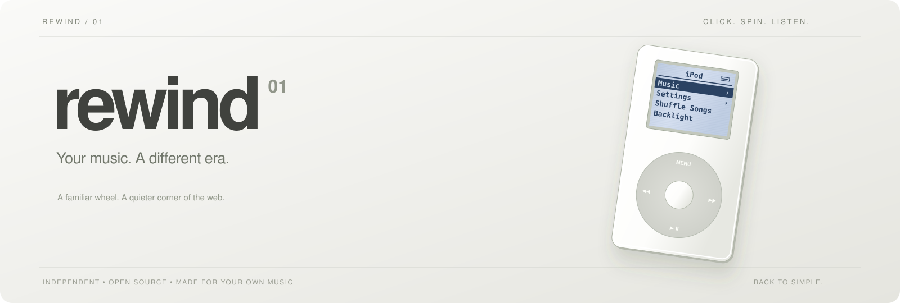
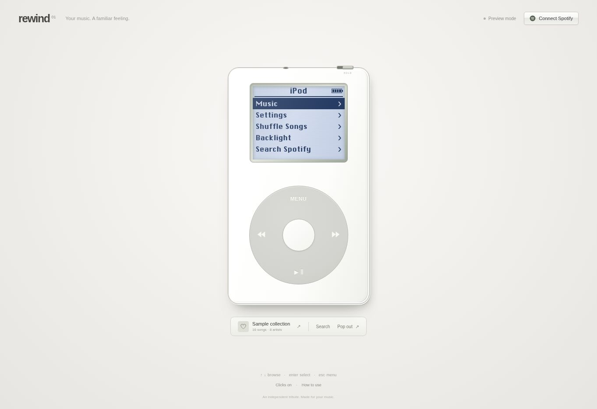
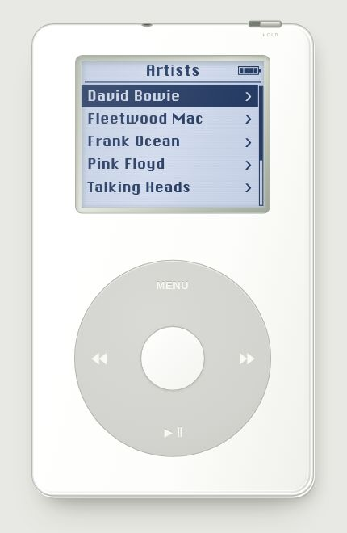

<p align="center">
  
</p>

<p align="center">
  <a href="https://rewind-spotify.pages.dev/">Open Rewind</a> ·
  <a href="#start-listening">Start listening</a> ·
  <a href="#run-it-yourself">Run it yourself</a> ·
  <a href="PRIVACY.md">Privacy</a>
</p>

Your Spotify collection, through a familiar Click Wheel. A quiet little web
player inspired by the white polycarbonate, monochrome display and thoughtful
simplicity of the fourth-generation iPod.

Spin the wheel. Pick a song. Put the rest away.

<p align="center"></p>

## A small player, a full collection

- Use **Liked Songs or any playlist** as your iPod library, grouped into artists,
  albums and songs, with complete pagination for larger collections.
- Search Spotify for songs, artists and albums beyond your library.
- Play, pause, skip, seek, change volume, shuffle, repeat, save a song and browse
  the queue. Listen in a supported browser or choose an active Spotify device.
- Turn the tactile wheel with a mouse or touch. Hear short, locally synthesized
  click sounds. Toggle the backlight or slide the HOLD switch.
- **Pop out** an iPod-only floating window. Keep the original tab open; closing
  the popup returns the same player to it.

## Start listening

**The public site never uses the publisher's Spotify account. Every listener
connects their own account and supplies their own Spotify app Client ID.**

1. [Open Rewind](https://rewind-spotify.pages.dev/) and try the sample library.
   The sample is interactive but has no audio.
2. With a **Spotify Premium** account, open the
   [Spotify Developer Dashboard](https://developer.spotify.com/dashboard) and
   create an app. Select **Web API** and **Web Playback SDK**.
3. Register the exact redirect URI shown in Rewind's **Connect Spotify** dialog.
   On the public site it is `https://rewind-spotify.pages.dev/` including the
   trailing slash. Your own deployment needs its own exact URI.
4. Paste your app's **Client ID** into Rewind. Never paste a Client Secret.
   Continue to Spotify and review the permissions for your account.
5. Start with Liked Songs, or choose a playlist using the collection button below
   the iPod. Select a song to play.

### Spotify's public-access limit

Spotify development apps currently allow **five approved users** and require the
app owner to have Premium. Additional users must be added under the app's
**User Management**. Signing in without that approval can still produce API 403
errors. Unlimited shared-app access requires Spotify extended-quota approval,
currently available only to qualifying organizations. Rewind does not bypass
these rules. The public version therefore uses **bring your own Spotify app**.

See Spotify's current [quota-mode rules](https://developer.spotify.com/documentation/web-api/concepts/quota-modes)
and [Web Playback SDK requirements](https://developer.spotify.com/documentation/web-playback-sdk).

## Familiar controls

| Action | Control |
| --- | --- |
| Browse | Drag around the wheel, scroll, or use ↑ / ↓ |
| Select | Centre button, Enter, or tap a display row |
| Back / home | MENU / hold MENU |
| Play or pause | Bottom wheel button or Space |
| Previous / next | Left / right wheel buttons |
| Volume / seek | On Now Playing, press centre to change mode, then turn the wheel |
| Search | Search in the menu, the dock button, or `/` |
| Lock controls | Top HOLD switch |
| Click sound | Footer button or Settings → Clicker |
| Floating player | Pop out; allow popups for this site if asked |
| Disconnect | Settings → Disconnect |

<p align="center"></p>

## Privacy by design

There is no shared account, bundled app ID, application database, analytics or
server-side token storage. Authentication uses OAuth PKCE directly with Spotify.
Tokens and your selected library stay in the current tab's session storage;
Disconnect clears them. Only appearance and click preferences persist locally.
Account names and emails are not shown by Rewind. Spotify's SDK requires profile
scopes for playback, and Spotify and the host process requests under their own
policies. Read [Privacy](PRIVACY.md) and [Security](SECURITY.md) for the details.

The screenshots above use the fixed sample collection, without an account.

## Run it yourself

No build framework, dependencies or secret environment variables are required.
Use Node.js 22 or newer for checks:

```sh
npm run check
npm test
```

Serve `dist/` with any static web server. For example, with Python installed:

```sh
python -m http.server 4173 --bind 127.0.0.1 --directory dist
```

Open `http://127.0.0.1:4173/` and register that exact loopback redirect URI in
your Spotify app. Spotify permits loopback HTTP with an explicit IP address;
use HTTPS for public deployments. `localhost` is not a supported redirect URI.

### Deploy with Cloudflare Pages

1. Fork this repository and create a Cloudflare Pages project connected to it.
2. Select **None** as the framework preset, use `npm run check && npm test` as
   the build command, and `dist` as the output directory. Production branch:
   `main`. Node's version is set by `.node-version`.
3. Deploy. Register your final HTTPS URL as a redirect in your Spotify app.
   Every listener uses their own app ID in the connection dialog.

Cloudflare Pages applies the security headers in `dist/_headers`. If you host
elsewhere, configure equivalent response headers. Do not add a Spotify Client
Secret, access token or refresh token to your build settings or source files.

## If playback needs a hand

| Symptom | What to check |
| --- | --- |
| 403 / permission denied | Premium, your app's user allowlist, granted scopes and playlist access |
| Redirect mismatch | Exact scheme, host, path, port and trailing slash in the developer dashboard |
| Browser player unavailable | Enable protected content / DRM and use a supported browser, or select an active Spotify device |
| No sound after sign-in | Select a song or press Play to satisfy the browser's audio gesture requirement |
| Rate limit | Wait for the retry time shown; avoid repeated refreshes |
| Popup blocked | Allow popups for Rewind, then select Pop out again |
| Wrong Spotify account | Disconnect in Rewind, sign out on Spotify if needed, then connect the intended account |

Browser support, Spotify permissions and platform policies can change. No offline
downloads, audio extraction or lyrics are provided.

## Credits and license

Independent, unofficial software. Not affiliated with or endorsed by Apple or
Spotify. iPod is an Apple trademark; music and artwork belong to their owners.
The interface is an homage to the original product design.

Code and original documentation: [MIT](LICENSE).
ChicagoFLF display font: [included public-domain notice](dist/fonts/LICENSE.txt).
